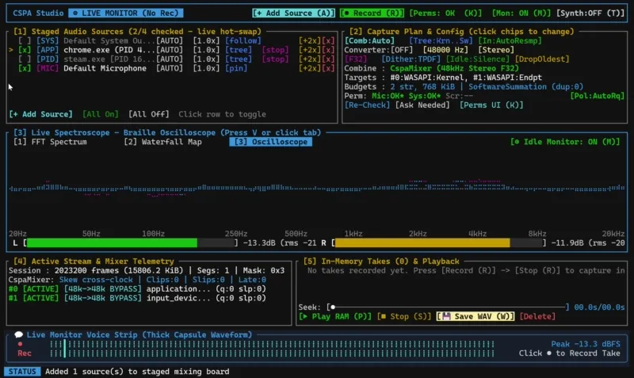

<div align="center">

  

  <h1 align="center">capture-system-or-process-audio</h1>

  <p>
    <b>Capture system speakers, isolate any single app/process, or mix microphones into one live PCM stream across Windows, Linux &amp; macOS.</b><br>
    <sub>Native WASAPI · PipeWire · PulseAudio · Core Audio Process Taps · ScreenCaptureKit — zero virtual audio cables, zero silent fallbacks.</sub><br>
  </p>
  <p>
    <a href="https://s0d3s.github.io/capture-system-or-process-audio/"></a>
    <a href="https://github.com/s0d3s/capture-system-or-process-audio/releases/latest"></a>
    <a href="https://github.com/s0d3s/capture-system-or-process-audio/actions/workflows/publish-release.yml"></a>
    <a href="#platform--backend-matrix"></a>
    <a href="#license"></a>
  </p>
  <p>
    <i>Created by <a href="https://github.com/s0d3s">@s0d3s</a> — author of <a href="https://github.com/s0d3s/PyAudioWPatch"><b>PyAudioWPatch</b></a> (140k+ monthly PyPI downloads, 340+ dependent repos) — released after nearly a year of ground-up safe-Rust engineering &amp; polish.</i>
  </p>


| SDK | Package / Distribution | Quick Start |
| :--- | :---: | :---: |
|  | [](https://pypi.org/project/capture-system-or-process-audio/) [](https://pypi.org/project/capture-system-or-process-audio/) | **[⚡ Quick Start ↓](#python-quick-start)** |
|  | [](https://crates.io/crates/capture-system-or-process-audio) [](https://docs.rs/capture-system-or-process-audio) | **[⚡ Quick Start ↓](#rust-quick-start)** |
|  | [](https://github.com/s0d3s/capture-system-or-process-audio/releases/latest) | **[⚡ Quick Start ↓](#cpp-quick-start)** |
|  | [](https://github.com/s0d3s/capture-system-or-process-audio/releases/latest) | **[⚡ Quick Start ↓](#c-quick-start)** |
|  |  | **[🚧 Planned ↓](#adapters-and-nodejs-roadmap)** |

  <p>
    <sub>
      <a href="https://s0d3s.github.io/capture-system-or-process-audio/"><b>Full Documentation &amp; API Reference</b></a> •
      <a href="#what-can-you-capture">Overview</a> •
      <a href="#interactive-studio-demo">Live TUI Demo</a> •
      <a href="#adapters-and-nodejs-roadmap">Drop-In Adapters Roadmap</a> •
      <a href="#why-this-exists--beyond-pyaudiowpatch">Why Not PyAudioWPatch?</a> •
      <a href="#platform--backend-matrix">OS Support</a> •
      <a href="#recording-permissions">Permissions</a> •
      <a href="#documentation--guides">Docs Map</a>
    </sub>
  </p>

</div>

---

## What Can You Capture?

`capture-system-or-process-audio` (`pip install capture-system-or-process-audio` / `cargo add capture-system-or-process-audio`) is a cross-platform native audio capture and live-mixing engine for **Windows 10/11** (`WASAPI`), **Linux** (`PipeWire` & `PulseAudio`), and **Apple Silicon macOS** (`Core Audio Process Taps` & `ScreenCaptureKit`). Describe *what* audio you want, and receive decoded PCM frames ready for `NumPy`, `faster-whisper` / `Whisper` STT, `OpenAI Realtime` / `LiveKit` voice agents, `WebRTC`, `Tauri` / desktop apps, DSP, or file encoders — **without installing VB-Cable, BlackHole, or Soundflower**:

- 🔊 **System / Speaker Loopback (`default_output`, `device`):** Capture audio playing on the user's speakers or headphones — automatically following OS default-device switches (`follow` default) or pinning a specific endpoint (`pin`).
- 🎯 **Single Application or Process Tree (`find_app`, `process`):** Isolate audio from *just* `Zoom`, `Microsoft Teams`, `Google Meet` (browser), `Spotify`, `Firefox`, or a game (including helper child processes where supported) without recording Discord notifications or unrelated apps.
- 🎙️ **Microphones & Audio Inputs (`microphone`, `input_device`):** Capture default or specific microphones with automatic sink-monitor exclusion and live device-switch tracking.
- 🎛️ **Drift-Compensated Multi-Source Mixing + Format Conversion:** Pass `[microphone(), find_app("Zoom")]` to receive **one synchronized PCM stream** converted on the fly (`16 kHz` mono `f32`/`i16` for `faster-whisper` & STT, `24 kHz` `i16` for Realtime Voice AI, or `48 kHz` stereo `f32` for `WebRTC` & studio recording) with **zero steady-state heap allocations** on `read_into`.

<div align="center">

  
  <br>
  <sub><b>Try it in 10 seconds without writing code:</b> Download <code>cspa-tui-demo</code> from <a href="https://github.com/s0d3s/capture-system-or-process-audio/releases/latest">Releases</a> to browse live apps/mics, hot-swap mixes while recording, and inspect real-time FFT, Waterfall, and Braille Oscilloscope views.</sub>

</div>

---

## Quick Starts by SDK

<a id="python-quick-start"></a>
### 🐍 Python Quick Start

Prebuilt binary wheels (`cp311-abi3`, `cp314t`, and PEP 803 `cp315-abi3.abi3t`) support **CPython `3.11`–`3.15`** plus **Free-Threaded Python `3.14t` & `3.15t` (`-Xgil=0`)** across Windows (`x64`/`ARM64`), Linux (`x86_64`/`aarch64` `manylinux_2_28`), and macOS (`arm64`) with zero mandatory runtime dependencies and complete `.pyi` type stubs.

```bash
pip install capture-system-or-process-audio
# Optional: zero-copy NumPy ndarray views via block.to_numpy()
pip install "capture-system-or-process-audio[numpy]"
# Inspect current platform/backends and live CaptureTargets in your terminal:
python -m capture_system_or_process_audio
```

**1. Capture default speakers (or isolate a single running application):**

```python
import capture_system_or_process_audio as cspa

# Capture default speakers/headphones (automatically follows OS device switches):
target = cspa.default_output()
# Or isolate one running application (and its audio helper processes):
# target = cspa.find_app("Spotify")

with cspa.capture(target) as stream:
    for outcome in stream:
        for block in outcome.blocks:
            pcm_view = memoryview(block)  # Zero-copy PEP 3118 read-only buffer
            print(f"{block.frames} frames @ {block.rate} Hz, {block.channels} ch ({block.sample_format.value}), {len(pcm_view)} B")
        break
```

**2. List, filter & use available `CaptureTarget`s deterministically:**

`cspa.find_app("Name")` is a quick single-match helper, but real desktops often run multiple instances, localized names, or multiple USB headsets. Enumerate `cspa.discover()` to filter deterministically by `active_audio`, `pid`, `executable_path`, `app_id`, or `device_id` and pass selected `CaptureTarget`s straight into `cspa.capture(...)`:

```python
import os
import capture_system_or_process_audio as cspa

catalog = cspa.discover(active_only=False)

for t in catalog.targets:
    print(f"{t.kind.value:12} name={t.name!r} pid={t.pid} active={t.active_audio} id={t.logical_id}")

# Deterministically pick active audio apps (excluding our own PID) or fall back to default output:
my_pid = os.getpid()
active_apps = [
    app.with_gain(0.9)
    for app in catalog.applications
    if app.active_audio is True and app.pid != my_pid and (app.executable_path or app.app_id or app.name)
]
selected = active_apps[:2] or [cspa.default_output()]

with cspa.capture(selected, silence_on_idle=True) as stream:
    outcome = stream.read(frames=480, timeout_ms=200)
    print(f"Captured {outcome.frames} frames from {len(stream.targets)} target(s)")
```

**3. Mix Microphone + Meeting App (`Zoom` / `Teams`) for `faster-whisper`, STT & Voice Agents:**

```python
import capture_system_or_process_audio as cspa

# 16 kHz mono f32 for faster-whisper / Whisper (or rate=24000, sample_format="i16" for OpenAI Realtime / LiveKit):
converter = cspa.OutputConverter(rate=16000, channels=1, sample_format="f32")

with cspa.capture(
    [cspa.microphone(), cspa.find_app("Zoom")],  # Or "Teams", "Chrome", etc.
    output_converter=converter,
    silence_on_idle=True,  # Emit continuous silent frames when speakers are idle
) as stream:
    outcome = stream.read(frames=1600, timeout_ms=200)  # 100 ms @ 16 kHz
    for block in outcome.blocks:
        samples = block.to_numpy()  # shape: (frames, 1), dtype: float32
```

<details>
<summary><b>More Python patterns: <code>asyncio</code>, zero-allocation <code>read_into</code>, callbacks &amp; live hot-swap</b></summary>

```python
import asyncio
import capture_system_or_process_audio as cspa

async def main() -> None:
    async with cspa.capture(cspa.default_output(), silence_on_idle=True) as stream:
        outcome = await stream.read_async(frames=480, timeout_ms=200)
        print("Async frames:", outcome.frames)

    # Zero-allocation steady-state read_into (safe on free-threaded Python 3.14t/3.15t):
    conv = cspa.OutputConverter(rate=48000, channels=2, sample_format="i16")
    with cspa.capture(cspa.default_output(), output_converter=conv, silence_on_idle=True) as sync_stream:
        buf = bytearray(480 * 2 * 2)
        res = sync_stream.read_into(buf, frames=480, timeout_ms=200)
        print("Copied bytes:", res.copy_bytes)

asyncio.run(main())
```

</details>

📖 **Python Docs:** [Python SDK Handbook](https://s0d3s.github.io/capture-system-or-process-audio/sdks/python/) • [Python API Reference](https://s0d3s.github.io/capture-system-or-process-audio/reference/python/functions/) • [Package README](crates/capture-python/README.md)

<p align="right"><sub><a href="#readme">↑ Back to SDKs</a></sub></p>

---

<a id="rust-quick-start"></a>
### 🦀 Rust Quick Start

The unified `capture-system-or-process-audio` facade crate enforces **`#![forbid(unsafe_code)]`** and automatically selects the native OS backend (`WASAPI`, `PipeWire`/`PulseAudio`, or `Core Audio`/`ScreenCaptureKit`) behind one single cross-platform API — ideal for **Tauri** desktop apps, native AI meeting assistants, real-time voice agents, and low-latency DSP engines.

```bash
cargo add capture-system-or-process-audio
```

```rust
use capture_system_or_process_audio::{
    CapabilityError, CaptureManager, CaptureTarget, DefaultDeviceMode, DiscoveryQuery,
    MixerConfig, PartialReason, Stop, capture_single, discover_query, request,
};
use std::time::Duration;

fn main() -> Result<(), CapabilityError> {
    // 1. Capture default output (follows OS default speaker/headphone switches):
    let target = CaptureTarget::default_output(DefaultDeviceMode::Follow);
    // Or isolate one running application (e.g. Zoom, Teams, Spotify):
    // let target = Discovery::new().find_app("Spotify", ProcessScope::Tree, OnRootExit::Stop)
    //     .map_err(|_| CapabilityError::NoSuchProcess)?;
    let mut manager = capture_single(target)?;

    // 2. Zero-allocation steady-state read into a reusable caller buffer (idle-speaker safe):
    let fmt = manager.output_format().expect("active output format").clone();
    let mut pcm_buf = vec![0u8; 480 * fmt.bytes_per_frame()];

    let res = manager
        .read_into(&mut pcm_buf, 480, Duration::from_millis(200))
        .expect("valid destination buffer");
    if res.frames == 0 && res.reason == PartialReason::Timeout {
        println!("Speakers are currently idle (enable silence_on_idle for continuous silence)");
    } else {
        println!(
            "Read {} frames ({} Hz, {} ch, {:?}, reason={:?})",
            res.frames,
            fmt.rate(),
            fmt.channels(),
            fmt.sample(),
            res.reason
        );
    }

    // 3. Deterministically list, filter & mix available CaptureTargets (excluding our own PID):
    let catalog = discover_query(&DiscoveryQuery::default())?;
    let self_pid = std::process::id();
    let mut selected: Vec<CaptureTarget> = catalog
        .applications
        .iter()
        .filter(|app| app.active_audio() == Some(true) && app.pid() != Some(self_pid))
        .take(2)
        .filter_map(|app| app.clone().with_gain(0.85).ok())
        .collect();
    selected.push(CaptureTarget::microphone(DefaultDeviceMode::Follow));

    let mix_req = request(selected).with_mixer_config(MixerConfig {
        silence_on_idle: true,
        ..MixerConfig::default()
    });
    let mut mix = CaptureManager::open(mix_req)?;
    if let Ok(block) = mix.read(480, Duration::from_millis(200)) {
        println!("Mixed {} frames ready for STT / WebRTC / Tauri IPC", block.frames);
    }
    mix.stop(Stop::Drain);
    mix.wait_cleanup(Duration::from_secs(2));

    manager.stop(Stop::Drain);
    manager.wait_cleanup(Duration::from_secs(2));
    Ok(())
}
```

📖 **Rust Docs:** [Rust SDK Handbook](https://s0d3s.github.io/capture-system-or-process-audio/sdks/rust/) • [Rust API Reference](https://s0d3s.github.io/capture-system-or-process-audio/reference/rust/overview/) • [docs.rs](https://docs.rs/capture-system-or-process-audio) • [Crate README](crates/capture/README.md)

<p align="right"><sub><a href="#readme">↑ Back to SDKs</a></sub></p>

---

<a id="cpp-quick-start"></a>
### ⚙️ C++17 Quick Start (Header-Only RAII)

Download the prebuilt `cspa-ffi-<version>-<target>` archive from [GitHub Releases](https://github.com/s0d3s/capture-system-or-process-audio/releases/latest) containing `include/cspa.hpp`, `include/cspa_experimental.h`, shared libraries, and `CspaConfig.cmake` — ready for native desktop recorders, **WebRTC** media clients, game/broadcast overlays, and local `whisper.cpp` / voice-AI pipelines. Supports **both** C++ exceptions (`/EHsc`, `-fexceptions` via `*_or_throw()`) and exception-free builds (`/EHs-c-`, `-fno-exceptions` via `cspa::Result<T>`).

```cmake
cmake_minimum_required(VERSION 3.20)
project(audio_example LANGUAGES CXX)

find_package(Cspa REQUIRED CONFIG)
add_executable(example main.cpp)
target_compile_features(example PRIVATE cxx_std_17)
target_link_libraries(example PRIVATE Cspa::cspa_ffi)
```

```cpp
#include <cspa.hpp>
#include <cstdio>
#include <vector>

int main() {
    auto disc_res = cspa::Discovery::create();
    if (!disc_res.is_ok()) return 1;
    cspa::Discovery disc = disc_res.take_value();

    // Deterministically list & filter available CaptureTargets (active apps + microphone):
    cspa::DiscoveryQuery query;
    auto catalog_res = disc.query(query);
    if (!catalog_res.is_ok()) return 1;

    std::vector<cspa::Target> selected;
    for (const cspa::Target &t : catalog_res.value()) {
        if (t.kind() == cspa::TargetKind::Application &&
            t.raw().active_audio == CSPA_ACTIVE_AUDIO_ACTIVE) {
            auto scaled = t.with_gain(0.85f);
            if (scaled.is_ok()) selected.push_back(scaled.take_value());
        }
    }
    if (selected.empty()) {
        selected.push_back(cspa::Target::default_output(cspa::DefaultDeviceMode::Follow).take_value());
    }
    selected.push_back(cspa::Target::microphone(cspa::DefaultDeviceMode::Follow).take_value());

    cspa::MixerConfig mixer;
    mixer.set_silence_on_idle(true);

    cspa::CaptureRequest req(std::move(selected));
    req.set_mixer_config(mixer)
       .set_output_converter(cspa::OutputConverter(48000, 2, cspa::SampleFormat::F32));

    auto stream_res = cspa::ManagedStream::open(req);
    if (!stream_res.is_ok()) return 1;
    cspa::ManagedStream stream = stream_res.take_value();

    std::vector<uint8_t> pcm(480 * 2 * sizeof(float));
    auto rd = stream.read_into(pcm.data(), pcm.size(), 480, 200);
    if (rd.is_ok()) {
        std::printf("Captured %llu mixed frames\n", static_cast<unsigned long long>(rd.value().frames));
    }

    stream.stop(false);
    stream.wait_cleanup(2000);
    return 0;
}
```

📖 **C++17 Docs:** [C++17 SDK Handbook](https://s0d3s.github.io/capture-system-or-process-audio/sdks/cpp/) • [C++17 API Reference](https://s0d3s.github.io/capture-system-or-process-audio/reference/cpp/classes-and-streams/) • [CMake & FFI SDK README](crates/capture-ffi/README.md)

<p align="right"><sub><a href="#readme">↑ Back to SDKs</a></sub></p>

---

<a id="c-quick-start"></a>
### 🧩 C11 Quick Start (Stable FFI Boundary)

`cspa_experimental.h` provides a size- and schema-revision-checked C11 ABI (`cspa_abi_check`) with `catch_unwind` panic containment across every exported symbol and **zero compile-time `NEEDED` links** to `libpipewire` or `libpulse` on Linux — ideal for C host applications, audio plugins, game engines, and custom FFI bindings (`Go`, `Zig`, `C#`, `Swift`).

```c
#include <cspa_experimental.h>
#include <stdint.h>
#include <stdio.h>

int main(void) {
    if (cspa_abi_check(CSPA_EXPERIMENTAL_ABI_MAJOR, CSPA_EXPERIMENTAL_SCHEMA_REVISION) != CSPA_STATUS_OK) {
        return 1;
    }

    /* 1. Deterministically enumerate & filter available CaptureTargets
          (or single-match by name via cspa_discovery_find_app(disc, "Spotify", ...)): */
    cspa_discovery_query_record query = {0};
    cspa_discovery_query_init(&query);
    cspa_capture_target_record discovered[32];
    size_t count = 0;

    cspa_capture_target_record target = {0};
    target.struct_size = (uint32_t)sizeof(target);
    target.schema_revision = CSPA_EXPERIMENTAL_SCHEMA_REVISION;
    int selected_active_app = 0;

    if (cspa_discover_query(&query, discovered, 32u, &count) == CSPA_STATUS_OK) {
        size_t n = count < 32u ? count : 32u;
        for (size_t i = 0; i < n; ++i) {
            if (discovered[i].kind == CSPA_TARGET_KIND_APPLICATION &&
                discovered[i].active_audio == CSPA_ACTIVE_AUDIO_ACTIVE) {
                target = discovered[i];
                selected_active_app = 1;
                break;
            }
        }
    }
    if (!selected_active_app &&
        cspa_target_default_output(CSPA_DEFAULT_DEVICE_FOLLOW, 1.0f, &target) != CSPA_STATUS_OK) {
        return 1;
    }

    /* 2. Open a managed session for the selected CaptureTarget: */
    cspa_capture_request_record req = {0};
    if (cspa_capture_request_init(&req, &target, 1u) != CSPA_STATUS_OK) return 1;

    cspa_manager *mgr = NULL;
    if (cspa_manager_open(&req, &mgr) != CSPA_STATUS_OK) return 1;

    uint8_t buffer[480 * 8];
    cspa_managed_read_outcome_record out = {0};
    out.struct_size = (uint32_t)sizeof(out);
    out.schema_revision = CSPA_EXPERIMENTAL_SCHEMA_REVISION;

    if (cspa_manager_read_into(mgr, buffer, sizeof(buffer), 480u, 200u, NULL, &out) == CSPA_STATUS_OK) {
        printf("Read %llu frames (%llu bytes)\n",
               (unsigned long long)out.actual_frames,
               (unsigned long long)out.copy_bytes);
    }

