<div align="center">

  

  <h1 align="center">capture-system-or-process-audio</h1>

  <p>
    <b>Unified <code>#![forbid(unsafe_code)]</code> cross-platform system speaker, per-application/process, and microphone PCM audio capture &amp; live mixer for Rust.</b><br>
    <sub>Native WASAPI · PipeWire · PulseAudio · Core Audio Process Taps · ScreenCaptureKit — zero virtual audio cables, zero steady-state allocations.</sub>
  </p>

  <p>
    <i>Created by <a href="https://github.com/s0d3s">@s0d3s</a> — author of <a href="https://github.com/s0d3s/PyAudioWPatch"><b>PyAudioWPatch</b></a> (140k+ monthly PyPI downloads), rebuilt from scratch in safe Rust.</i>
  </p>

  <p>
    <a href="https://s0d3s.github.io/capture-system-or-process-audio/sdks/rust/"></a>
    <a href="https://crates.io/crates/capture-system-or-process-audio"></a>
    <a href="https://docs.rs/capture-system-or-process-audio"></a>
    <a href="https://crates.io/crates/capture-system-or-process-audio"></a>
    <a href="https://github.com/s0d3s/capture-system-or-process-audio#platform--backend-matrix"></a>
    <a href="https://github.com/s0d3s/capture-system-or-process-audio/blob/main/LICENSE-MIT"></a>
  </p>

</div>

---

## Installation

```bash
cargo add capture-system-or-process-audio
```

`capture-system-or-process-audio` selects the active OS backend (`WASAPI`, `PipeWire`/`PulseAudio`, or `Core Audio`/`ScreenCaptureKit`) in **one single place** behind a 100% platform-agnostic safe-Rust API (`#![forbid(unsafe_code)]`) — your application crate never needs per-OS `#[cfg]` backend dispatch.

---

## Quick Start

### 1. Capture Default Speakers & Zero-Allocation `read_into`

```rust,no_run
use capture_system_or_process_audio::{
    CapabilityError, CaptureTarget, DefaultDeviceMode, Stop, capture_single,
};
use std::time::Duration;

fn main() -> Result<(), CapabilityError> {
    // Follows OS default speaker/headphone switches automatically (or pass DefaultDeviceMode::Pin):
    let target = CaptureTarget::default_output(DefaultDeviceMode::Follow);
    let mut manager = capture_single(target)?;

    let fmt = manager.output_format().expect("active output format").clone();
    let mut pcm_buf = vec![0u8; 480 * fmt.bytes_per_frame()];

    // Warmed read_into performs 0 steady-state heap allocations:
    let res = manager
        .read_into(&mut pcm_buf, 480, Duration::from_millis(200))
        .expect("read PCM block");
    println!(
        "Read {} frames ({} Hz, {} ch, {:?})",
        res.frames,
        fmt.rate(),
        fmt.channels(),
        fmt.sample()
    );

    manager.stop(Stop::Drain);
    manager.wait_cleanup(Duration::from_secs(2));
    Ok(())
}
```

### 2. List, Filter & Capture `CaptureTarget`s Deterministically (`discover_query`)

`Discovery::find_app("Name", ...)` is a single-match shortcut that fails if multiple instances run or display names differ across locales/packaging. Enumerating `discover_query` lets you inspect every available `CaptureTarget` (`applications`, `processes`, `output_devices`, `input_devices`), filter deterministically on `active_audio()`, `pid()`, `app_id()`, `executable_path()`, or `clean_device_id()`, refine with `.with_gain(...)` / `.with_backend(...)`, and pass the selected targets directly into `CaptureManager`:

```rust,no_run
use capture_system_or_process_audio::{
    CapabilityError, CaptureManager, CaptureTarget, DefaultDeviceMode, DiscoveryQuery,
    MixerConfig, Stop, discover_query, request,
};
use std::time::Duration;

fn main() -> Result<(), CapabilityError> {
    let catalog = discover_query(&DiscoveryQuery::default())?;
    for t in &catalog.targets {
        println!(
            "kind={:?} name={:?} pid={:?} active={:?} id={}",
            t.kind(),
            t.name().map(|s| s.as_ref()),
            t.pid(),
            t.active_audio(),
            t.logical_id()
        );
    }

    let self_pid = std::process::id();
    let mut selected: Vec<CaptureTarget> = catalog
        .applications
        .iter()
        .filter(|app| app.active_audio() == Some(true) && app.pid() != Some(self_pid))
        .take(2)
        .filter_map(|app| app.clone().with_gain(0.85).ok())
        .collect();
    if selected.is_empty() {
        selected.push(CaptureTarget::default_output(DefaultDeviceMode::Follow));
    }

    let req = request(selected).with_mixer_config(MixerConfig {
        silence_on_idle: true,
        ..MixerConfig::default()
    });
    let mut manager = CaptureManager::open(req)?;
    let block = manager.read(480, Duration::from_millis(200)).expect("read PCM block");
    println!("Captured {} frames", block.frames);

    manager.stop(Stop::Drain);
    manager.wait_cleanup(Duration::from_secs(2));
    Ok(())
}
```

### 3. Mix Microphone + Single Application at `16 kHz` Mono `I16`

```rust,no_run
use capture_system_or_process_audio::{
    ByteOrder, CapabilityError, CaptureManager, CaptureTarget, Channel, DefaultDeviceMode,
    Discovery, DitherMode, Format, Layout, MixerConfig, OnRootExit, OutputConverterConfig,
    ProcessScope, SampleType, Stop, request,
};
use std::{sync::Arc, time::Duration};

fn main() -> Result<(), CapabilityError> {
    let mic = CaptureTarget::microphone(DefaultDeviceMode::Follow);
    let app = Discovery::new()
        .find_app("Spotify", ProcessScope::Tree, OnRootExit::Stop)
        .map_err(|_| CapabilityError::NoSuchProcess)?;

    let mono_16k = Format::new(
        SampleType::I16,
        ByteOrder::Little,
        16_000,
        1,
        Layout::Known(Arc::from([Channel::Mono])),
    )
    .expect("valid 16 kHz mono format");

    let req = request(vec![mic, app])
        .with_mixer_config(MixerConfig {
            silence_on_idle: true,
            ..MixerConfig::default()
        })
        .with_output_converter(Some(OutputConverterConfig::new(mono_16k, DitherMode::Tpdf)));

    // Optional side-effect-free execution plan preview before opening OS streams:
    let plan = req.inspect()?;
    println!("Combine resolution: {:?} (streams={})", plan.combine_resolution, plan.estimated_active_streams);

    let mut manager = CaptureManager::open(req)?;
    let block = manager.read(1600, Duration::from_millis(200)).expect("read 100 ms mixed audio");
    println!("Mixed {} frames", block.frames);

    manager.stop(Stop::Drain);
    manager.wait_cleanup(Duration::from_secs(2));
    Ok(())
}
```

### 4. Check & Request OS Recording Permissions

```rust,no_run
use capture_system_or_process_audio::{
    CapabilityError, CaptureTarget, DefaultDeviceMode, check_permissions, request_permissions,
};
use std::time::Duration;

fn main() -> Result<(), CapabilityError> {
    let target = CaptureTarget::default_output(DefaultDeviceMode::Follow);

    // Non-prompting preflight across Microphone, SystemAudio, and ScreenRecording:
    let report = check_permissions(std::slice::from_ref(&target))?;
    if !report.system_audio().is_granted() {
        let _updated = request_permissions(std::slice::from_ref(&target), Duration::from_secs(30))?;
    }
    Ok(())
}
```

---

## Choosing Between `CaptureManager` and `AudioStream`

- **`CaptureManager` (`capture`, `capture_single`, `CaptureManager::open`) — Recommended Default:**
  Uses a zero-extra-copy `PassThrough` path for single targets while owning multi-target native graph fan-in (`SharedNativeGraphMix`), drift-compensated software mixing (`CspaMixer` + pre-mix `InputNormalizer + FrameReblocker`), post-mix `OutputConverter`, automatic `Follow` default-device switching, `OnRootExit::Wait` relaunch tracking, and live two-tier `update_targets(...)` hot-swap.
- **`AudioStream` (`open_stream`, `AudioStream::open`) — Lightweight Single Session:**
  Owns a single native backend capture stream directly when you explicitly want zero discovery subscriptions, process-tree monitoring, or device-switch transitions.

---

## Platform & Native Backend Matrix

Unsupported scopes or OS versions fail explicitly with `CapabilityError` — never silently broadening from single-process capture to full-system loopback:

| Platform | Crate Backend | Supported Targets & Capabilities | Runtime Notes |
| --- | --- | --- | --- |
| **Windows 10 / 11** (`x86_64`, `aarch64`) | `capture-system-or-process-audio-windows` (`WASAPI`) | `default_output` & `microphone` (`Follow`/`Pin`), `device` & `input_device` (`>= 19041`); `process` & `application` `ProcessScope::Tree` (`>= 20348`). | `ProcessScope::Exact` rejects explicitly (`CapabilityError::UnsupportedScope`). |
| **Linux** (`x86_64`, `aarch64`) | `capture-system-or-process-audio-linux` (`PipeWire` `0.3.65+`, `PulseAudio` `15.0+`) | Output endpoints, microphones (`.monitor` sinks excluded), PipeWire `SharedNativeGraphMix` virtual-sink fan-in, PulseAudio per-stream `CspaMixer`, and `[PipeWire + PulseAudio]` cross-backend mixing. | Loads `libpipewire-0.3.so.0` & `libpulse.so.0` via `dlopen` (**`0` compile-time `NEEDED` links**). |
| **macOS** (`aarch64`, `x86_64`) | `capture-system-or-process-audio-macos` (`Core Audio`, `ScreenCaptureKit`) | Core Audio Process Taps (`macOS 14.2+`), Core Audio HAL microphone input (`macOS 13.0+`), ScreenCaptureKit `application` (`ProcessScope::Exact`, `macOS 13.0+`), and `[SCK + CoreAudio]` cross-backend mixing. | SCK `ProcessScope::Tree` rejects explicitly (`CapabilityError::UnsupportedScope`). |

---

## Repository, Other SDKs & License

- **Official Documentation, Manuals & Multi-SDK Reference:** <https://s0d3s.github.io/capture-system-or-process-audio/>
- **GitHub Repository (Python, C++17, C11 SDKs & `cspa-tui-demo`):** <https://github.com/s0d3s/capture-system-or-process-audio>
- **License:** Dual-licensed under [MIT](https://github.com/s0d3s/capture-system-or-process-audio/blob/main/LICENSE-MIT) or [Apache-2.0](https://github.com/s0d3s/capture-system-or-process-audio/blob/main/LICENSE-APACHE), at your option.
